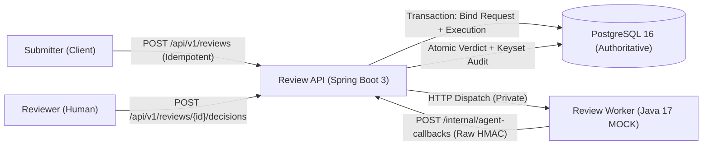

# Tenvyr: Asynchronous Code Review Service

Java and Spring Boot 3 (Java 17) backend portfolio demonstrating a fixed asynchronous review workflow with a private **Java HTTP Worker** and **PostgreSQL 16**.

The service coordinates a reliable business workflow: submitters submit code snippets, an isolated review worker generates score and diagnostic findings (default configuration generates an explicit offline `MOCK` fixture without source code analysis or external LLM calls), and designated reviewers record binding human verdicts (`APPROVE` or `REQUEST_CHANGES`) backed by an immutable audit trail.



## Business Workflow & Core Architecture

1. **Idempotent Submission & Request Binding:** Submitters authenticate via form session with CSRF protection and submit code snippets. Submissions are deduplicated via client `Idempotency-Key` headers inside a single database transaction binding the business request and underlying engine execution attempt (preventing duplicate request/execution records; compute retries remain lease-driven without exactly-once worker compute claims).
2. **Private Asynchronous Review Worker:** A dedicated Java HTTP worker processes code submissions against bounded queues (concurrency: 2, capacity: 16). In default showcase mode, it runs offline with an explicit `MOCK` score and diagnostic findings fixture (no code analysis, external LLM, or live code execution).
3. **Signed HMAC Callback:** The worker delivers results to `/internal/agent-callbacks/http/code-reviewer` authenticated with SHA-256 HMAC signatures over canonical raw body bytes, bounded to 1 MiB with replay protection.
4. **Report Provenance & Keyset Reads:** Reports are projected strictly from verified `APPLIED` inbox rows matching the execution step. Listings use stable keyset pagination (`createdAt DESC, id DESC`).
5. **Human Verdicts & Cancel Races:** Authenticated reviewers (enforcing separation of duties: author cannot review their own submission) record binding verdicts (`APPROVE` or `REQUEST_CHANGES`). Strict row-level locking (`FOR UPDATE`) resolves races between reviewer decisions and owner cancellations cleanly without duplicate state transitions.
6. **Crash Recovery & Auditability:** Process restarts re-login safely and recover uncompleted work naturally via database leasing; session cookies require dynamic re-validation against PostgreSQL roles on every request. Business actions record immutable audit entries (`SUBMIT`, `DECIDE`, and `CANCEL` when used; callback evidence resides in the engine inbox).

### Source Architecture

| Component | Source Path | Description |
| --- | --- | --- |
| **Review Application** | [ReviewApplication.java](backend/review-api/src/main/java/io/tenvyr/review/ReviewApplication.java) | Spring Boot 3 entrypoint and auto-configuration |
| **Business Facade** | [ReviewService.java](backend/review-api/src/main/java/io/tenvyr/review/ReviewService.java) | Transactional submission, keyset reads, and report projection |
| **Decision & Audit** | [ReviewDecisionService.java](backend/review-api/src/main/java/io/tenvyr/review/ReviewDecisionService.java) | Concurrent-safe verdicts, cancellations, and keyset audit log |
| **Data Repository** | [ReviewRepository.java](backend/review-api/src/main/java/io/tenvyr/review/ReviewRepository.java) | Keyset pagination, row-level locks, and backlog metrics query |
| **Security & Auth** | [ReviewSecurityConfiguration.java](backend/review-api/src/main/java/io/tenvyr/review/ReviewSecurityConfiguration.java) | Session auth, CSRF rotation, RBAC, and raw HMAC exemption |
| **Lifecycle & Seam** | [EngineLifecycle.java](backend/review-api/src/main/java/io/tenvyr/review/EngineLifecycle.java) | Embedded [ControlPlaneRuntime.java](backend/control-plane/src/main/java/io/tenvyr/control/ControlPlaneRuntime.java) lifecycle seam |
| **Review Worker** | [ReviewWorkerMain.java](backend/review-worker/src/main/java/io/tenvyr/reviewworker/ReviewWorkerMain.java) | Isolated Java HTTP worker with [StrictReviewRunner.java](backend/review-worker/src/main/java/io/tenvyr/reviewworker/StrictReviewRunner.java) |

## Demonstration Walkthrough

Run the self-contained three-container review showcase (`review-api`, `review-worker`, `postgres`). The demonstration sequence takes ~5 minutes once containers are ready (initial image build and cold tool pulls vary by environment).

### Prerequisites
- Linux or WSL2 (Ubuntu 22.04+ recommended)
- Node.js 22+, Git, `tar`, and Docker Compose v2.24+
- *Note:* Host JDK 17 and Maven are required for local tests/builds, but Docker Compose builds run hermetically with internal build tools. No Kafka, Zookeeper, Node backend, frontend, or paid LLM provider credentials are required.

### Quick Start Commands

```bash
# 1. (Optional) Set custom port if default 8080 is occupied
export TENVYR_REVIEW_PORT=18080

# 2. Start self-contained topology (API loopback on 127.0.0.1:18080)
sh scripts/review-showcase.sh up

# 3. Execute automated 3-actor verification smoke test
node scripts/review-smoke.mjs

# 4. Tear down containers (preserves database volume and credentials)
sh scripts/review-showcase.sh down
```

### Runtime Security & Persistence Guarantees
- **Private State:** Runtime credentials and secrets are generated in `~/.tenvyr/review-runtime` with POSIX file mode `0600` and directory `0700` (insecure/world-writable mounts fail closed).
- **Network Isolation:** Only `review-api` is bound to host loopback `127.0.0.1:${TENVYR_REVIEW_PORT:-8080}`; worker and database remain private on an internal bridge network.
- **Data Retention:** `review-showcase.sh down` preserves the Docker-managed named volume `tenvyr_review_pgdata` (stored in Docker volume storage, not in the private runtime directory) and user UUIDs across cycles. Restarting recovers existing state.
- **Fail-Safe Restart:** The API container uses `restart: "no"` to prevent crash loops; recovery is performed explicitly via `review-showcase.sh up`.

## Benchmark & Load Verification

The review showcase includes a bounded 100-request / concurrency 4 benchmark harness separating immediate admission latency from asynchronous worker completion:

```bash
# Run offline self-check (no network or credentials required)
node scripts/review-benchmark.mjs --self-check

# Run benchmark against active showcase (output JSON evidence)
node scripts/review-benchmark.mjs --output docs/_scratch/review-benchmark.json
```
*(Actual 100-request / concurrency-4 empirical measurements are pending root gate execution; no synthetic SLA or throughput is claimed.)*

## Current Status & Verification (16 Nov 2026)

- **Portfolio Plan:** 8 of 9 tasks accepted locally ([T00–T07](docs/plans/active/spring-review-portfolio/README.md)); T08 final acceptance in progress.
- **Automated Verification:** Full review gate PASSED in 10m23s: 89 Surefire tests (44 API + 45 Worker including 13 HTTP loopbacks) and 120 real PostgreSQL ITs across 15 suites with 0 failures, 0 errors, 0 skipped (including 16 Access Matrix, 2 Concurrency, and 4 Process Crash & Recovery). Full retained backend `--integration` check is running serially; benchmark 100-request C4 numbers remain pending.
- **Open Limitations:** External production exposure gate, HTTPS live provider integrations, and worker process-local outbox durability remain open boundaries.

## Architecture Documentation & Retained Legacy

The review service reuses Tenvyr's underlying 27 PostgreSQL database migrations, engine composition, and polyglot SDK architecture without breaking compatibility:

- [Review Architecture & Seam](docs/architecture/review-service.md) — Reusable engine lifecycle, pooled JDBC seam, and transaction boundaries.
- [Review Operations Guide](docs/operations/review-showcase.md) — Container topology, environment configuration, and troubleshooting.
- [Portfolio Case Study](docs/showcase/case-study.md) — Engineering problem, architectural tradeoffs, and recovery proofs.
- [Showcase Demo Guide](docs/showcase/demo-guide.md) — Step-by-step 5-minute walkthrough script with roles and sample calls.
- [Implementation Status Ledger](docs/reference/implementation-status.md) — Machine-readable capability ledger ([JSON](docs/reference/implementation-status.json)).
- [Documentation Index](docs/README.md) — Full index covering legacy multi-agent runtimes, Kafka adapters, and SDKs.

*Legacy Multi-Agent Showcase:* The original polyglot multi-agent platform (TypeScript/Python workers, Kafka runtime, Operator Workbench, and `pnpm showcase:*` commands) is preserved intact. See the [documentation index](docs/README.md) for legacy guides.
